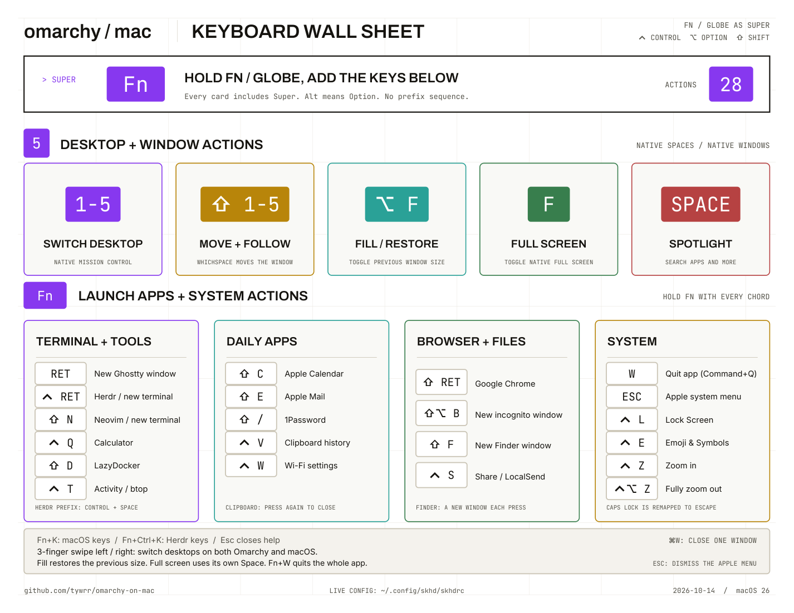
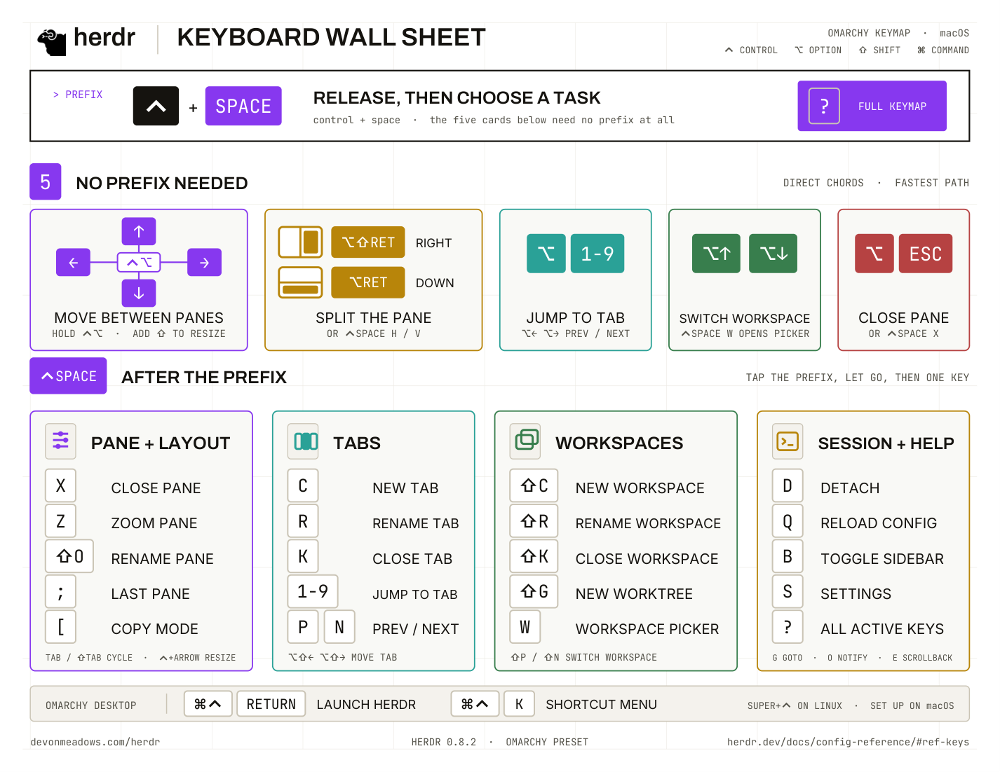

# Omarchy on Mac

An [Omarchy](https://github.com/omacom/omarchy)-inspired keyboard workflow with
**Fn/Globe as Super** and **skhd.zig as the central hotkey map**. Native macOS
handles desktops and window actions, WhichSpace moves windows and displays the
current desktop, and Vorssaint supplies clipboard history.

Fn stays a real modifier. Shift, Control, and Option remain separate layers;
Command keeps its usual macOS shortcuts. No Hyper or Right Option remapping is
needed.

The one-page keyboard wall sheets are available in both themes:

| Sheet | Light | Dark |
|---|---|---|
| Omarchy on Mac - current Fn shortcuts | [PDF](output/pdf/omarchy-on-mac-keybindings.pdf) | [PDF](output/pdf/omarchy-on-mac-keybindings-dark.pdf) |
| Herdr - original Omarchy keymap reference | [PDF](output/pdf/herdr-keybindings-omarchy.pdf) | [PDF](output/pdf/herdr-keybindings-omarchy-dark.pdf) |

**macOS shortcuts**

<picture>
  <source media="(prefers-color-scheme: dark)" srcset="assets/previews/omarchy-on-mac-keybindings-dark.png">
  <source media="(prefers-color-scheme: light)" srcset="assets/previews/omarchy-on-mac-keybindings.png">
  
</picture>

**Herdr shortcuts**

<picture>
  <source media="(prefers-color-scheme: dark)" srcset="assets/previews/herdr-keybindings-omarchy-dark.png">
  <source media="(prefers-color-scheme: light)" srcset="assets/previews/herdr-keybindings-omarchy.png">
  
</picture>

Previews follow GitHub's light or dark theme. Use the PDF links above for the
full-size printable sheets.

Rebuild the macOS light sheet with `uv run scripts/build_cheatsheet.py`; the
builder checks shortcut coverage against `skhd/skhdrc`. Then run
`uv run scripts/build_dark_cheatsheets.py` to regenerate both dark sheets, and
`uv run scripts/build_previews.py` to refresh all four README images.
The dark versions preserve selectable text, vector artwork, and the original
layout. Fonts and licenses for the macOS builder are in `assets/fonts/`.

The Herdr light sheet is the original PDF from `Documents/cheat sheets`, including
its printed Herdr 0.8.2 preset and desktop-launch annotations. For the current
macOS launch shortcuts, use the Omarchy on Mac sheet or the table below.

## Searchable keyboard panel

**Fn+K** opens the macOS sheet; **Fn+Control+K** opens the Herdr sheet. Repeating
the same shortcut toggles its panel, and the other shortcut switches sheets.
Search has focus immediately. Type a word to highlight matches; Return or
Command+G advances, and Shift+Return or Command+Shift+G goes back. Command+F
returns to the search field. Escape closes the panel and restores the previous
app's focus; clicking another app dismisses it too.

The small AppKit/PDFKit app uses the bundled dark PDFs and has no Dock icon.
It launches on demand and quits when dismissed, releasing its document cache
and process memory. It appears over the current desktop. skhd owns the global hotkeys;
the panel needs no additional Accessibility or Input Monitoring permission and
does not save search history.

Restore builds it into `~/Applications/Omarchy Keys.app`. To update only the
panel after regenerating a PDF or editing its source, run
`python3 scripts/install_panel.py`. The installer rebuilds only when its source,
metadata, or bundled PDFs change; an update stops only the panel helper, which
launches again on the next hotkey.

## Current stack

| Component | Responsibility | Version used |
|---|---|---|
| [skhd.zig](https://github.com/jackielii/skhd.zig) | All user-facing Fn bindings, app launches, and key forwarding | 0.2.0-7e95d99 (fast) |
| Native macOS | Mission Control desktops, Spotlight, full screen, Lock Screen, emoji picker, Apple menu, window tiling | 26.7.1 |
| [WhichSpace](https://github.com/gechr/WhichSpace) | Desktop indicator and moving windows between native desktops | 1.4.1 |
| [Vorssaint](https://github.com/vorssaint/vorssaint-utils) | Clipboard history | 3.4.1 (101) |
| Ghostty / Herdr | Terminal and agent manager | Existing installations |

This setup uses ordinary skhd event-tap hotkeys and built-in key forwarding.
Its optional grabber and virtual HID driver are not installed. Earlier
BetterTouchTool presets remain under [legacy/bettertouchtool](legacy/bettertouchtool/).

## Active shortcuts

**Super = Fn/Globe. Alt = Option.** All bindings below live in [skhd/skhdrc](skhd/skhdrc).

| Shortcut | Action | Target |
|---|---|---|
| Super + K | Show/toggle the searchable macOS keyboard sheet | Native panel |
| Super + Control + K | Show/toggle the searchable Herdr keyboard sheet | Native panel |
| Super + Return | Open a new Ghostty terminal window on every press | App launch |
| Super + Control + Return | Start Herdr in a new Ghostty instance | App launch |
| Super + Shift + Return | Open/focus Chrome | App launch |
| Super + Shift + Option + B | New Chrome incognito window | App launch |
| Super + Shift + F | Create and focus a new Finder window on every press | Native helper |
| Super + Control + Q | Open/focus Calculator | App launch |
| Super + Control + S | Share: open/focus LocalSend | App launch |
| Super + Shift + C | Open/focus Apple Calendar | App launch |
| Super + Shift + E | Open/focus Apple Mail | App launch |
| Super + Shift + / | Open/focus 1Password | App launch |
| Super + Shift + N | Start Neovim in a new Ghostty instance | App launch |
| Super + Shift + D | Start LazyDocker in a new Ghostty window | App launch |
| Super + Control + T | Activity: start btop in a new Ghostty window | App launch |
| Super + Control + W | Open Wi-Fi settings | Native System Settings URL |
| Super + Control + V | Toggle Vorssaint clipboard history | Control+Option+Command+V |
| Super + 1–5 | Switch to Desktop 1–5 | Native Control+1–5 |
| Super + Shift + 1–5 | Move the focused window to Desktop 1–5 and follow it | WhichSpace Control+Shift+1–5 |
| Super + Space | Spotlight | Command+Space |
| Super + W | Quit the active app | Command+Q |
| Super + F | Toggle native full screen | Native helper |
| Super + Option + F | Toggle Fill / Return to Previous Size | Native helper |
| Super + Escape | Open the Apple menu (Sleep, Restart, etc.) | Native helper |
| Super + Control + L | Lock Screen | Control+Command+Q |
| Super + Control + E | Emoji & Symbols picker | Control+Command+Space |
| Super + Control + Z | Zoom in one step | Native Option+Command+= |
| Super + Control + Option + Z | Fully zoom out; no change if already out | Native helper |

Fn+W quits the application, as requested; Command+W remains the ordinary close-window
shortcut. A Caps Lock key already remapped to Escape should also trigger Fn+Escape.
Apple keyboards can turn Fn+Return into keypad Enter, so both Return keycodes are
included for the three Return bindings.
The plain terminal launcher uses `open -na /Applications/Ghostty.app`, creating
a new instance/window even when Ghostty is already running.

**Trackpad:** a three-finger swipe left or right switches desktops on both
Omarchy and macOS.

Zoom uses **System Settings → Accessibility → Zoom → Use keyboard shortcuts to
zoom**. Keep the native Zoom shortcuts enabled: Option+Command+= to zoom in,
Option+Command+- to zoom out, and Option+Command+8 to toggle. The reset helper
checks the public `UAZoomEnabled()` API before invoking the toggle, so pressing
reset while already fully out does not zoom back in. Zoom preferences remain
managed in System Settings and are not changed by the portable restore script.

## How forwarding works

macOS retains its normal **Control+1–5** desktop shortcuts and **Command+Space**
Spotlight shortcut. WhichSpace uses recordable **Control+Shift+1–5** Move shortcuts;
these are configured bindings, not factory defaults. Vorssaint uses its factory
clipboard shortcut, **Control+Option+Command+V**. Their recorders do not need to
understand Fn.

skhd's built-in `|` forwarding translates the Fn chord inside the running event
tap. It does not start a shell or another skhd process for these mappings.
For example:

```text
fn - 2 | ctrl - 2
fn + shift - 2 | ctrl + shift - 2
fn + ctrl - v | ctrl + alt + cmd - v
```

The small [native helper](skhd/toggle-fill.swift) handles Fill, full screen,
opening the Apple menu, creating new Finder windows, and resetting Accessibility
Zoom. Restore compiles it
as `~/.config/skhd/toggle-fill`. It runs only when invoked. Fill uses macOS's own
previous-size history; no custom window-position store is maintained. Its Fill
and Finder menu lookups currently require English menu titles. Full-screen and
nonstandard windows are ignored by the Fill action.

The user confirmed Fill in Finder, Chrome, Calendar, and Ghostty, and confirmed
the clipboard binding. Dated [verification notes](research/) describe runtime
tests and distinguish them from physical-key confirmation. Older reports of
Fn configured directly in macOS/WhichSpace describe the superseded setup.

## Files

| Path | Contents |
|---|---|
| [skhd/skhdrc](skhd/skhdrc) | Central Fn bindings; installed at `~/.config/skhd/skhdrc` |
| [skhd/toggle-fill.swift](skhd/toggle-fill.swift) | Native Accessibility helper source |
| [panel](panel/) | Native searchable PDF panel source and bundle metadata |
| [scripts/install_panel.py](scripts/install_panel.py) | Build the panel and bundle both dark PDFs |
| [assets/previews](assets/previews/) | Light/dark PNG sheets displayed in this README |
| [macos/desktop-shortcuts.plist](macos/desktop-shortcuts.plist) | Native Control+1–5 bindings, symbolic IDs 118–122 |
| [whichspace/settings.plist](whichspace/settings.plist) | Control+Shift+1–5 Move bindings and menu-bar appearance |
| [vorssaint/settings.plist](vorssaint/settings.plist) | Only clipboard shortcut configuration; no history |
| [scripts/settings.py](scripts/settings.py) | Back up and restore portable settings |
| [backups](backups/) | Timestamped rollback snapshots |
| [config.toml](config.toml) | Existing Herdr configuration; kept at its original path |
| [research](research/) | Research and dated implementation evidence |

## Set up or restore

Requires macOS 26+, Homebrew, Python 3, and Xcode Command Line Tools
(`xcode-select --install`) to build the native helper. App launches expect
Ghostty and Chrome in `/Applications`, and Herdr at
`~/.local/share/mise/shims/herdr`. Neovim uses the existing mise shim at
`~/.local/share/mise/shims/nvim`. LazyDocker uses
`~/.local/share/mise/shims/lazydocker` and requires a running Docker-compatible
engine (OrbStack on this Mac). Activity uses Homebrew's `/opt/homebrew/bin/btop`
(`brew install btop` on Apple Silicon). The additional app bindings expect 1Password,
Apple Calendar, Apple Mail, and LocalSend to be installed. Install and run Vorssaint for clipboard history.

```sh
brew install jackielii/tap/skhd-zig
brew install --cask whichspace
open -a WhichSpace
```

Create five ordinary Mission Control desktops. For stable numbering, disable
**Automatically rearrange Spaces based on most recent use** under System Settings
→ Desktop & Dock → Mission Control. Keep native Spotlight's Command+Space enabled.

From this repository:

```sh
python3 scripts/settings.py restore --dry-run
python3 scripts/settings.py restore
skhd --start-service
skhd --status
```

Grant the requested Accessibility/Input Monitoring permissions to skhd and
Accessibility to WhichSpace. These per-Mac permissions are not restored from
preference files. The native helper avoids Apple Events and System Events
scripting.

Restore first makes a rollback snapshot, installs the skhd config and helper
source, builds the helper when needed, and merges the selected settings. It
restarts WhichSpace/Vorssaint only when their settings change and they were
running. It reloads native shortcuts and an already-running skhd. It preserves
other native hotkeys and app settings and does not create desktops. The live
restore path has been exercised; a fresh-Mac setup has not.

Keep overlapping BTT bindings disabled when using this stack.

## Back up changes

```sh
python3 scripts/settings.py backup
git diff
```

Backup saves full WhichSpace and native symbolic-hotkey preferences, the live
skhd config, and the native helper source. It saves only four Vorssaint clipboard
configuration keys, never clipboard entries or other Vorssaint settings. It
also refreshes the portable configs. The compiled helper is rebuilt rather than
committed. Full WhichSpace snapshots include machine-specific Space/display IDs;
its portable file excludes those values.

## Transfer updates to the personal repo

Use one incremental package against the actual published `origin/main`, rather
than choosing between generic "latest" and "complete" patches:

```sh
python3 scripts/export_update.py
```

Commit the source changes first. The exporter fetches public `origin/main`,
excludes commits whose patches have already been published (even if `git am`
changed their hashes), and applies the remaining commits to that exact base in
an isolated checkout. It then exports and test-applies the full series, including
binary PDF/font files, in another clean checkout. Conflicts stop the export.
The active branch and live macOS settings are not changed.

Downloads receives a patch and a ZIP named with the published base and source
commit. Transfer the ZIP and extract it outside your personal checkout. If a
previous `git am` failed, first run `git am --abort` in that checkout. Then:

```sh
cd /path/to/personal/omarchy-on-mac
python3 /path/to/extracted/apply-update.py --check
python3 /path/to/extracted/apply-update.py
```

The packaged helper checks for pending Git operations, uncommitted files, the
required base tree, and a matching patch checksum before applying. It verifies
the final tree afterward. A repeated application is detected without changing
files. A different destination state stops with an explanation; publish that
state and export again rather than forcing the patch. This transfers repo files
only; settings are applied separately with `scripts/settings.py restore`.

## Where to edit the settings

- **Fn bindings:** `~/.config/skhd/skhdrc`, then `skhd --reload`.
- **Native desktops:** System Settings → Keyboard → Keyboard Shortcuts → Mission Control;
  these now show Control+1–5 normally. The domain is `com.apple.symbolichotkeys`.
- **WhichSpace:** Settings → Keyboard Shortcuts; Move uses Control+Shift+1–5.
- **Vorssaint:** Settings → Clipboard → Shortcut; keep Control+Option+Command+V.

The Shortcuts app is not involved. Native Fill (ID 237) retains its default
Fn+Control+F; skhd handles the separate Fn+Option+F toggle.

## Herdr configuration

The root [config.toml](config.toml) retains the existing Herdr configuration.
For a new Mac without an existing config:

```sh
mkdir -p ~/.config/herdr
ln -s "$PWD/config.toml" ~/.config/herdr/config.toml
```

Herdr's prefix remains Control+Space. Its skhd launcher uses the existing working
Ghostty command. Repeated Herdr and incognito shortcuts request new instances/windows.

Only shortcuts in the active table have been migrated. Additional BTT actions
remain in the legacy files. The reference is the
[Omarchy hotkeys manual](https://github.com/omacom/omarchy/blob/quattro/manual/07-hotkeys.md).
